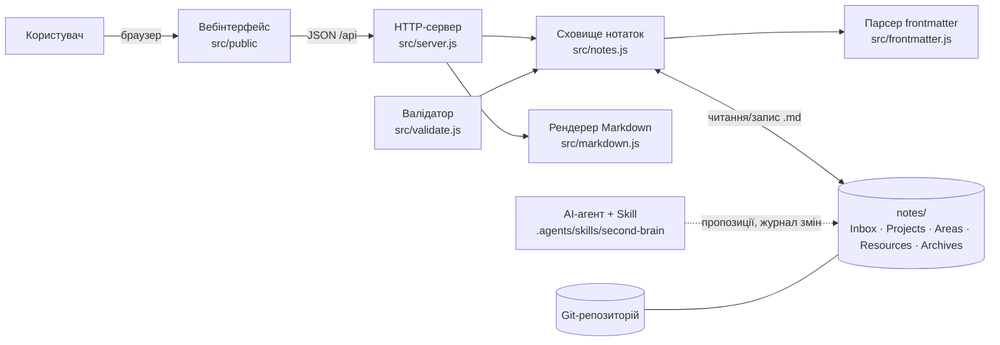
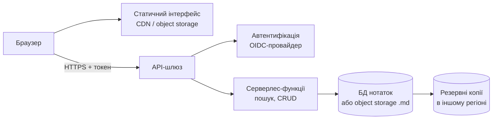

# Архітектура Second Brain

## 1. Контекст і користувач
Система призначена для одного користувача-студента, який веде особисті навчальні нотатки.
Вона працює локально, без акаунтів і без зовнішніх сервісів: нотатки — це звичайні `.md`-файли в каталозі `notes/`.

## 2. Компоненти

| Компонент | Відповідальність |
|-----------|------------------|
| Вебінтерфейс | список, категорії, теги, пошук, перегляд, створення/редагування, архівування |
| HTTP-сервер | маршрути `/api/*`, статичні файли, перевірки безпеки |
| Сховище | індекс нотаток, пошук із ранжуванням, фільтри, зворотні посилання, запис файлів |
| Рендерер | безпечне перетворення Markdown у HTML, розбір `[[вікі-посилань]]` |
| Валідатор | перевірка обов’язкових полів, значень, битих посилань, відповідності Archives ↔ archived |
| Agent Skill | правила для агента: класифікація, теги, зв’язки, журнал змін |

## 3. Модель даних
Кожна нотатка — файл `notes/<Категорія>/<Назва>.md` із YAML frontmatter:

| Поле | Значення |
|------|----------|
| `title` | назва; за нею розв’язуються вікі-посилання |
| `created`, `updated` | дати `РРРР-ММ-ДД` |
| `type` | `resource`, `project`, `area`, `moc`, `idea`, `draft` |
| `status` | `inbox`, `active`, `archived` |
| `tags` | список тегів (нижній регістр, слова через дефіс) |
| `source` | походження матеріалу; не вигадується |

Ідентифікатор нотатки — шлях без розширення (`Resources/Основи Git`). Зв’язки — `[[Назва]]` або `[[Назва|текст]]`.

## 4. Потоки даних
1. **Читання.** Сервер перед кожним запитом перечитує `notes/`, будує індекс і віддає список або одну нотатку з готовим HTML.
2. **Пошук і фільтри.** Усі слова запиту мають зустрітися у назві, тегах або тексті; збіг у назві важить більше, ніж у тегах, а в тегах — більше, ніж у тексті.
3. **Запис.** Створення використовує режим `wx` (не перезаписує існуючий файл); оновлення змінює `updated`; видалення через API відсутнє, є лише архівування (перенесення в `Archives/`).
4. **Агент.** Агент змінює лише файли проєкту і лише після підтвердження користувача; всі пропозиції фіксуються в журналі.

## 5. Критерії приймання
| № | Критерій |
|---|----------|
| A1 | Можна створити нотатку через інтерфейс; файл з’являється в `notes/` з коректним frontmatter |
| A2 | Пошук за словом знаходить нотатки за назвою, тегом і текстом незалежно від регістру |
| A3 | Фільтр за тегом, категорією та статусом працює і комбінується з пошуком |
| A4 | Внутрішнє посилання `[[…]]` відкриває цільову нотатку; бите посилання видно |
| A5 | Порожній результат показує зрозуміле повідомлення, а не помилку |
| A6 | Після перезапуску сервера дані збережені |
| A7 | Застосунок працює без інтернету та без зовнішніх API |
| A8 | Нотатки не видаляються через застосунок; архівування зберігає зміст |
| A9 | Автотести та валідатор проходять без помилок |

## 6. Ризики
| Ризик | Заходи |
|-------|--------|
| Витік персональних даних | локальне зберігання; сервер слухає лише `127.0.0.1`; секрети й чутливі дані не вносяться; `.gitignore` для `.env` |
| Втрата даних | Git для історії + правило 3-2-1 (копія на іншому носії та у віддаленому репозиторії); Git сам по собі не є резервною копією |
| Пошкодження або «вигадування» агентом | агент працює лише в проєкті; підтвердження перед переміщенням; `npm run validate` і автотести цілісності |
| XSS через вміст нотаток | увесь HTML екранується; небезпечні URL відкидаються; CSP `default-src 'self'` |
| Атаки на локальний сервер | перевірка Host (DNS rebinding), запис лише з `application/json`, відсутність CORS |
| Path traversal | `id` перевіряється за переліком категорій, шлях обмежений каталогом `notes/` |

## 7. Хмарне розширення (проєктне рішення, без розгортання)

Потрібні компоненти: статичний хостинг, автентифікація, API, сховище (БД або бакет із `.md`), резервування, моніторинг і шифрування під час передавання та зберігання.

### Порівняння локальної та хмарної версій
| Критерій | Локальна | Хмарна |
|----------|----------|--------|
| Приватність | найвища: дані не залишають пристрою | дані в провайдера; потрібні шифрування, політики доступу |
| Доступність | лише на своєму пристрої | з будь-якого пристрою, синхронізація |
| Вартість | практично нульова | плата за сховище, обчислення, трафік |
| Vendor lock-in | мінімальний (відкриті файли `.md`) | залежить від обраних керованих сервісів; зменшується вибором сумісних API та експортом `.md` |
| Складність експлуатації | низька, але резервування на користувачі | вища: автентифікація, оновлення, моніторинг, інциденти |
| Резервування | власна відповідальність | може надаватися сервісом, але його треба налаштувати й перевіряти |
